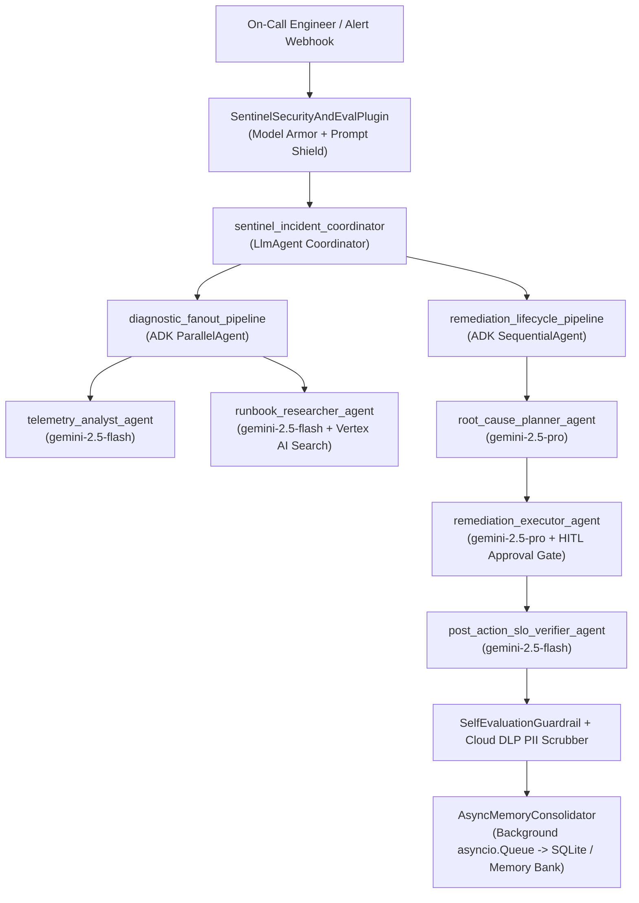

# Sentinel SRE — Enterprise Incident Triage & Autonomous Remediation Agent

**Track:** Enterprise Agents (AI in 5 Days Assessment Agent)  
**Framework:** [Google Agent Development Kit (ADK) for Python](https://google.github.io/adk-docs/) & **Vertex AI Agent Engine**

---

## 1. Problem & Solution Statement

### Problem
Enterprise Site Reliability Engineering (SRE) and Cloud Support teams lose critical minutes during production incidents correlating Cloud Monitoring golden signals, searching scattered runbooks, redacting customer PII from war-room logs, and manually verifying Service Level Objective (SLO) recovery after rollbacks—while purely autonomous scripts risk unapproved production state mutations.

### Solution
**Sentinel SRE (`sentinel_sre_agent`)** is a multi-agent incident triage and remediation system built on **Google ADK** and **Vertex AI Agent Engine**. It combines concurrent diagnostic fan-out (`ParallelAgent`), grounded runbook retrieval via **Vertex AI Search**, strategic **Gemini 2.5 Flash / Pro** model routing, **Google Cloud Model Armor** + self-evaluation guardrails, cryptographic **Human-in-the-Loop (HITL)** approval gates on all production rollbacks/SEV-1 pages, **OpenTelemetry / Cloud Trace** distributed tracing, **Cloud DLP** PII scrubbing, and **Secret Manager** credential injection.

---

## 2. Multi-Agent Architecture



---

## 3. Quickstart & Agent CLI (`adk` / `agent-starter-pack`) Usage

### Install Dependencies
```bash
python3 -m venv .venv
source .venv/bin/activate
pip install -e ".[dev]"
cp .env.example .env
```

### Run Locally with the Google ADK CLI (`adk`)
Launch the interactive ADK Developer Web UI (with trace graph, session state inspector, and HITL confirmation prompts):
```bash
adk web .
```

Or run an interactive terminal session directly via `adk run`:
```bash
adk run sentinel_sre_agent
```

### Run Automated Golden-Dataset Evaluations (`adk eval` & `pytest`)
Execute the deterministic unit, security, observability, and golden-dataset regression harness:
```bash
python3 -m unittest discover -s tests -p "test_*.py" -v
# Or with pytest + coverage:
pytest -v --cov=sentinel_sre_agent
```

Run the ADK CLI evaluator against the golden `EvalSet` (`tests/eval/sentinel_golden.evalset.json`):
```bash
adk eval sentinel_sre_agent tests/eval/sentinel_golden.evalset.json \
  --config_file_path tests/eval/eval_config.json
```

### Deploy to Vertex AI Agent Engine (`adk deploy` & `agent-starter-pack`)
Deploy directly to **Vertex AI Agent Engine** using the ADK CLI:
```bash
export GOOGLE_CLOUD_PROJECT="your-gcp-project-id"
export GOOGLE_CLOUD_LOCATION="us-central1"

adk deploy agent_engine \
  --project="${GOOGLE_CLOUD_PROJECT}" \
  --region="${GOOGLE_CLOUD_LOCATION}" \
  --display_name="Sentinel SRE Multi-Agent System" \
  sentinel_sre_agent
```

Or scaffold/enhance CI/CD & Cloud Run / Agent Engine deployment pipelines with the **Google Cloud Agent Starter Pack CLI**:
```bash
uvx agent-starter-pack enhance --adk -d agent_engine --region us-central1
```

---

## 4. Infrastructure as Code (Terraform)

All backing Google Cloud resources—**Vertex AI Search** runbook datastore, **Cloud SQL PostgreSQL** session database, **Secret Manager** secret containers, **Cloud DLP** de-identification templates, **Artifact Registry**, and least-privilege **IAM Service Accounts**—are declaratively provisioned in `terraform/`:

```bash
terraform -chdir=terraform init
terraform -chdir=terraform validate
terraform -chdir=terraform plan \
  -var="project_id=${GOOGLE_CLOUD_PROJECT}" \
  -var="region=us-central1" \
  -var="environment=prod"
terraform -chdir=terraform apply \
  -var="project_id=${GOOGLE_CLOUD_PROJECT}" \
  -var="region=us-central1" \
  -var="environment=prod"
```

Populate secret versions securely via `gcloud secrets versions add` (never commit secret values to Git):
```bash
printf "%s" "postgresql+asyncpg://..." | \
  gcloud secrets versions add sentinel-session-db-url --data-file=-
```

---

## 5. AgentOps Code Review Matrix Mapping (95 / 95 Points)

| Category | Criteria | Implementation Evidence in Repository |
| :--- | :--- | :--- |
| **1. Tool & Interface Design** | **Comprehensive Tool Docstrings** | `sentinel_sre_agent/tools/telemetry_tools.py`, `knowledge_tools.py`, `remediation_tools.py` — full Google-style docstrings (`Args`, `Returns`, HITL & recovery semantics). |
| | **Descriptive Naming** | `query_service_golden_signals_telemetry`, `verify_post_remediation_slo_burn_rate`, `search_verified_sre_runbooks`, `execute_canary_rollback_with_approval`, `create_critical_incident_escalation`. |
| | **Explicit JSON Schemas** | `sentinel_sre_agent/schemas/tool_contracts.py` — strict Pydantic v2 `BaseModel` input & output schemas (`extra="forbid"`, `strict=True`, regex patterns, numeric bounds) + `TOOL_JSON_SCHEMAS`. |
| | **Guided Error Handling** | `GuidedToolErrorResponse` & `format_validation_error_with_guidance` return structured `recovery_instructions`, `error_code`, and `allowed_values` instead of crashing. |
| **2. Context & Memory** | **Robust System Instructions** | `sentinel_sre_agent/prompts/constitution.py` — `<agent_constitution>` defining `<persona>`, `<domain_knowledge>`, `<hard_constraints>`, and `<output_contract>`. |
| | **History Compaction** | `sentinel_sre_agent/memory/compaction.py` — ADK `EventsCompactionConfig`, Vertex AI `ContextCacheConfig`, and `TokenBudgetHistoryCompactor` sliding-window summarizer. |
| | **Persistent Session State** | `sentinel_sre_agent/memory/session_store.py` & `tools/knowledge_tools.py` — `VertexAiSessionService` / `DatabaseSessionService`, SQLite + vector store, `VertexAiMemoryBankService`, and **Vertex AI Search** (`discoveryengine_v1`). |
| | **Async Memory Operations** | `sentinel_sre_agent/memory/async_consolidator.py` — non-blocking `asyncio.Queue` + background `asyncio.create_task` worker (`AsyncMemoryConsolidator`). |
| **3. Orchestration & Logic** | **Multi-Agent Patterns** | `sentinel_sre_agent/agent.py` — ADK `LlmAgent` Coordinator orchestrating `ParallelAgent` (`diagnostic_fanout_pipeline`) and `SequentialAgent` (`remediation_lifecycle_pipeline`). |
| | **Strategic Model Routing** | `sentinel_sre_agent/orchestration/model_router.py` — `StrategicModelRouter` routing low-latency tasks to `gemini-2.5-flash` and complex planning/SEV-1 analysis to `gemini-2.5-pro`. |
| | **Guardrails & Policy Plugins** | `sentinel_sre_agent/orchestration/guardrails_plugin.py` — ADK `BasePlugin` (`SentinelSecurityAndEvalPlugin`) integrating **Google Cloud Model Armor** + `SelfEvaluationGuardrail`. |
| | **Human-in-the-Loop Hooks** | `sentinel_sre_agent/orchestration/hitl_hooks.py` & `tools/remediation_tools.py` — ADK `FunctionTool(..., require_confirmation=True)`, `ToolContext.request_confirmation`, and HMAC-signed `HumanApprovalGate`. |
| **4. Observability & Tracing** | **Structured JSON Logging** | `sentinel_sre_agent/observability/structured_logger.py` — Cloud-Logging-compatible structured JSON logger (`structlog` / JSON records; zero `print()` statements enforced by AST test). |
| | **Intent vs. Outcome Capture** | `sentinel_sre_agent/observability/intent_outcome_audit.py` — paired `AGENT_ACTION_INTENT` (pre-execution) and `AGENT_ACTION_OUTCOME` (post-execution) events linked by `correlation_id`. |
| | **Distributed Tracing** | `sentinel_sre_agent/observability/tracing.py` — OpenTelemetry `TracerProvider`, `CloudTraceSpanExporter`, and linked parent-child spans from ingress to egress. |
| | **PII Redaction** | `sentinel_sre_agent/observability/pii_redactor.py` — active scrubbing via **Google Cloud DLP API** (`dlp_v2`) + deterministic regex fallback before logging or memory writes. |
| **5. Infrastructure & CI/CD** | **Automated Evaluation Suites** | `sentinel_sre_agent/evaluation.py`, `tests/eval/sentinel_golden.evalset.json`, `tests/eval/golden_cases.json`, and `.github/workflows/agentops-ci.yml`. |
| | **Infrastructure as Code** | `terraform/` (`versions.tf`, `variables.tf`, `main.tf`, `iam.tf`, `outputs.tf`) + `Makefile` + `adk` / `agent-starter-pack` CLI workflows documented above. |
| | **Secure Secret Management** | `sentinel_sre_agent/security/secret_manager.py` — runtime secret injection via **Google Cloud Secret Manager** + automated repo-wide secret hygiene scan test. |
